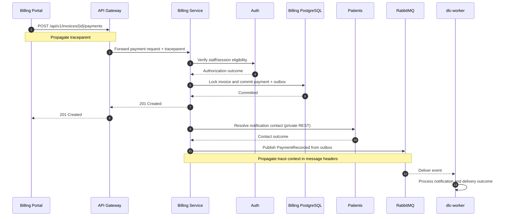

<!-- WEEK 11 - CP1: CRITICAL JOURNEY
     Project: DI LUCCA Dental Care & Technology
     Domain: Billing
     Keep documented contracts separate from proposed tracing. -->
# CP1 - Critical Journey and Trace Propagation
## 1. Journey identification
| Field | Description |
|---|---|
| Project | DI LUCCA Dental Care & Technology |
| Domain | Billing |
| User story | HU-BIL-003 |
| Journey | Record an invoice payment |
| Entry point | POST /api/v1/invoices/{id}/payments |
| Operation | BillingRecordpayment |
| Authorized roles | ADMINISTRATOR, SECRETARY_ASSISTANT |
| Success response | 201 Created |
## 2. Business objective
Allow authorized staff to record an internal or simulated
invoice payment without exceeding the outstanding balance.
Billing locks the invoice and atomically updates its payment
total, remaining balance, and financial status.
A successful payment requests a separate email notification.
Notification failures must never reverse the committed payment.
## 3. Component hops
| Hop | Component | Responsibility |
|---|---|---|
| 1 | dlc-billing-portal / dlc-front | Submit authorized payment |
| 2 | API Gateway | Route protected HTTP request |
| 3 | Billing Service | Validate command and permissions |
| 4 | Auth | Check staff/session eligibility |
| 5 | billing PostgreSQL | Commit payment and balance update |
| 6 | Billing outbox / RabbitMQ | Publish PaymentRecorded fact |
| 7 | Patients | Resolve contact after financial commit |
| 8 | dlc-worker | Deliver notification asynchronously |

## 4. Distributed sequence

The trace propagation shown below is proposed instrumentation.
It does not claim that tracing is already deployed.



## 5. Proposed span tree

```text
trace: record-invoice-payment
|
+-- gateway.http.request
    |
    +-- billing.record_payment
        |
        +-- auth.check_session
        |
        +-- billing.invoice_lock_and_payment_commit
            |
            +-- billing.postgresql.transaction
            +-- billing.outbox.persist

Async continuation (linked context):
|
+-- billing.outbox.publish
+-- patients.resolve_contact
+-- worker.payment_notification
    |
    +-- worker.email_delivery
```

Each operation receives its own span_id and retains the
trace_id or an explicit trace link where appropriate.

## 6. Trace propagation contract

| Boundary | Proposed propagation |
|---|---|
| Portal to Gateway | W3C traceparent HTTP header |
| Gateway to Billing | Forward validated trace context |
| Billing to Auth/Patients | Inject traceparent into private REST |
| Billing to RabbitMQ | Include trace context in message headers |
| RabbitMQ to dlc-worker | Extract context and link consumer span |
| Structured logs | Include trace_id and span_id |

Do not log credentials, session tokens, patient contact details,
or payment-sensitive data.

## 7. Failure and recovery cases

| Failure | Expected behavior |
|---|---|
| Unauthorized staff | Reject before financial mutation |
| Stale expectedVersion | 409 STALE_VERSION |
| Payment exceeds balance | 409 PAYMENT_EXCEEDS_BALANCE |
| Non-payable invoice | 409 INVOICE_NOT_PAYABLE |
| Patients unavailable after commit | Keep payment; handle notification failure |
| Broker or worker unavailable | Preserve outbox; retry delivery |
| Email provider failure | Keep payment; report delivery outcome |

## 8. Documentation references

- `dlc-docs/07-api/contracts/openapi/billing-service.yaml`
- `dlc-docs/09-microservices/dependency-map.md`
- `dlc-docs/09-microservices/communication-patterns.md`
- `dlc-docs/09-microservices/services/06-billing-service/README.md`

## 9. CP1 validation

- [x] Real Billing user story and endpoint identified
- [x] At least three documented components included
- [x] Synchronous and asynchronous boundaries identified
- [x] Mermaid sequence diagram provided
- [x] Proposed trace propagation documented
- [x] Span tree and failure scenarios documented
- [ ] Git commit and push recorded
