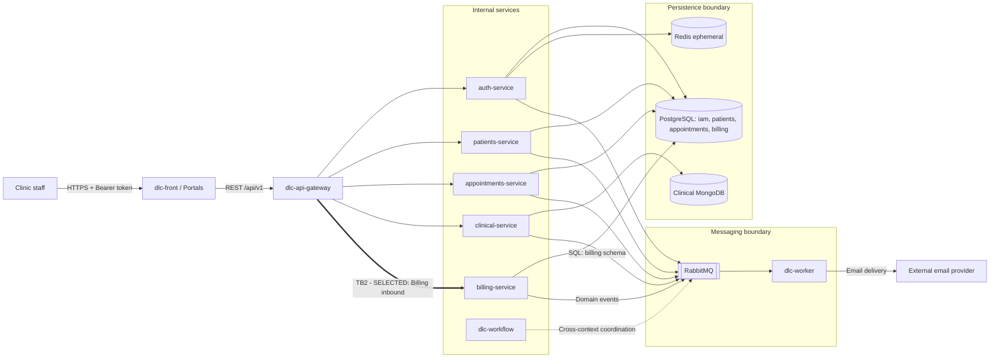

# CP1 — Attack Surface and Trust Boundaries

## System: DI LUCCA Dental Care & Technology

This document maps the main components, data flows, and trust boundaries of DI LUCCA, focusing on inbound communication from the API Gateway to the Billing service.

## 1. Data Flow Diagram

## 2. Trust Boundary Inventory

| ID | Trust boundary | Security concern |
|---|---|---|
| TB1 | Clinic frontend -> API Gateway | User authentication and request validation |
| TB2 | API Gateway -> Billing service (SELECTED) | Service access, authorization, request integrity |
| TB3 | Billing service -> PostgreSQL billing schema | Data integrity and database permissions |
| TB4 | Billing service -> RabbitMQ | Event integrity and message authorization |
| TB5 | RabbitMQ -> dlc-worker | Consumer trust and notification processing |
| TB6 | dlc-worker -> Email provider | External communication and data disclosure |
| TB7 | Clinical service -> MongoDB | Clinical record confidentiality |

## 3. Billing Asset Inventory

| Asset | Location | Classification |
|---|---|---|
| Procedure price catalog | PostgreSQL billing schema | Internal |
| Invoice and payment records | PostgreSQL billing schema | Confidential |
| Manual charge records | PostgreSQL billing schema | Confidential |
| Billing authorization roles | IAM service and Billing API contract | Restricted |
| Patient billing identifiers | Billing records and API requests | Confidential |
| Invoice PDF content | Billing service, generated on demand | Confidential |
| Billing domain events | RabbitMQ and Billing outbox | Internal |

## 4. Selected Boundary: TB2

**Source:** dlc-api-gateway

**Destination:** billing-service (dlc-billing-api)

**Direction:** Inbound

**Data crossing the boundary:** Bearer credentials, billing requests, price information, invoice identifiers, payment information, and manual charge data.

### Documented entry points

| Entry point | Caller | Documented security |
|---|---|---|
| GET /api/v1/procedure-prices | Authorized clinic staff via Gateway | Bearer token; ADMINISTRATOR, DENTIST, SECRETARY_ASSISTANT |
| POST /api/v1/procedure-prices | Administrator via Gateway | Bearer token; ADMINISTRATOR; Idempotency-Key |
| /api/v1/invoices | Clinic staff via Gateway | Bearer authentication; operation-specific roles to verify |
| /api/v1/invoices/{id}/payments | Clinic staff via Gateway | Bearer authentication; operation-specific roles to verify |
| /api/v1/manual-charges | Clinic staff via Gateway | Bearer authentication; operation-specific roles to verify |

The Billing OpenAPI contract declares bearer authentication and role requirements. Actual enforcement must be verified through implementation and negative authorization tests.

## 5. Security Focus

TB2 will be analyzed with STRIDE to identify identity spoofing, unauthorized price manipulation, missing audit evidence, financial data exposure, request flooding, and privilege escalation.

**Architecture reference:** `dlc-docs/05-architecture/overview.md`

**API contract:** `dlc-docs/07-api/contracts/openapi/billing-service.yaml`
